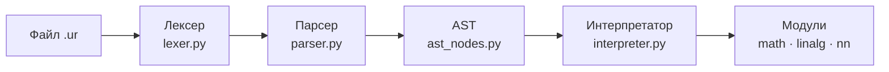

<div align="center">


<h1>U-Ray</h1>

### Свой язык программирования — от первых циклов до обучения нейросетей

Интерпретируемый язык с собственным синтаксисом, понятной семантикой и встроенными инструментами для ML.

<p>
  <a href="https://github.com/TechnoSwey/U-Ray/actions/workflows/ci.yml"></a>
  
  
  
</p>

<a href="#быстрый-старт">Быстрый старт</a> · <a href="#возможности">Возможности</a> · <a href="#примеры">Примеры</a> · <a href="#документация">Документация</a> · <a href="#тесты">Тесты</a>

</div>

---

U-Ray — компактный скриптовый язык, в котором можно изучать устройство интерпретатора и экспериментировать с нейросетями без обязательных сторонних библиотек.

```uray
func factorial(n) {
    if n <= 1 {
        return 1
    }
    return n * factorial(n - 1)
}

for i in range(1, 6) {
    print(i, "! =", factorial(i))
}
```

## Быстрый старт

Нужен Python 3.10 или новее. Обязательные внешние зависимости не требуются.

```bash
git clone https://github.com/TechnoSwey/U-Ray.git
cd U-Ray
./install.sh
./uray examples/save_load.ur
```

Без установки запускай файл через Python:

```bash
python3 main.py examples/save_load.ur
```

Интерактивный режим и CLI:

```bash
./uray --help
./uray --version
./uray --repl
./uray examples/numpy_backend.ur --backend=numpy
./uray examples/mnist.ur --backend=native
./uray examples/mnist_cnn.ur --backend=numpy
./uray examples/tabular_classification.ur
./uray check examples/mlp_xor.ur
./uray fmt examples/mlp_xor.ur
./uray fmt --write examples/mlp_xor.ur
```

Без имени файла `uray` тоже открывает REPL. Стандартный `python` backend не
требует сторонних библиотек. `--backend=native` использует встроенные C-ядра
для обучения, оценки и предсказания обычных MLP, не импортирует NumPy и не
зависит от сторонних ML-библиотек. При первом запуске он собирает исходник
ядра системным C-компилятором (`cc`, `clang` или `gcc`) и кэширует его во
временном каталоге; на Windows нативная сборка пока не поддерживается.
`--backend=numpy` остаётся дополнительным вариантом для NumPy-ускорения и
компонуемых CNN/autodiff-примеров. `nn.load_mnist("data/mnist", true)` скачивает
недостающие стандартные архивы, проверяет IDX-структуру и возвращает train/test
без разворачивания всех изображений в Python-списки. `nn.load_csv(...)`
загружает числовые признаки из CSV, воспроизводимо делит данные на train/test,
по запросу нормализует их и кодирует категориальные метки one-hot. Примеры
`mnist.ur`, `mnist_cnn.ur` и `tabular_classification.ur` показывают загрузку,
обучение и оценку моделей.
В интерактивном режиме Tab дополняет имена переменных, встроенные функции,
модули и поля структур на платформах с Python `readline`.

## Возможности

| Язык | Математика | Машинное обучение |
| --- | --- | --- |
| Функции, рекурсия, условия и циклы | Встроенные `math` и `linalg` | `nn`: MLP, native CPU backend, autodiff, CNN и Transformer |
| Списки, словари, кортежи и строки | Python по умолчанию, native C и NumPy по выбору | Dense-, сверточные и residual-блоки |
| Деструктуризация структур в `match` | Self-attention с causal-маской | BatchNorm, LayerNorm, Dropout и Adam |
| REPL с Tab-дополнением и CLI | `uray fmt` для единого стиля | Предварительная проверка размерностей ML |
| Сохранение и загрузка моделей | Без обязательных зависимостей | Подсветка для VS Code и Termux |

`uray fmt file.ur` печатает отформатированный код; для записи используй
`uray fmt --write file.ur`, а `uray fmt --check file.ur` подходит для CI.
Перед выполнением файла U-Ray проверяет известные размерности. Команда
`uray check file.ur` запускает эту проверку без исполнения программы.

Расширение VS Code доступно локально в
[`vscode/uray-language`](vscode/uray-language/README.md); публикации в
Marketplace пока нет. Настройки подсветки для Termux (`nano`, Vim, Neovim и `micro`)
описаны в [`termux/README.md`](termux/README.md). Встроенная Tab-подсказка
работает в REPL на платформах с модулем `readline`; Jupyter kernel в этот
релиз не входит.

Файл модели `.pt` экспортируется при отдельно установленном PyTorch
(`python3 -m pip install torch`). Экспорт содержит параметры и описание
архитектуры; обучение и импорт PyTorch-моделей в U-Ray не входят в этот формат.

## От исходника до результата



## Пример: нейросеть XOR

Создай MLP, обучи на четырёх точках и проверь результат:

```uray
import nn

X = [[0.0, 0.0], [0.0, 1.0], [1.0, 0.0], [1.0, 1.0]]
Y = [[0.0], [1.0], [1.0], [0.0]]

model = nn.mlp([2, 4, 1], "sigmoid")
history = nn.train(model, X, Y, 2000, 0.5, 4, "mse", "sgd")
metrics = nn.evaluate(model, X, Y, "mse")
print("loss:", metrics[0])
print("accuracy:", metrics[1])
```

## Примеры

В репозитории есть запускаемые ML-примеры:

| Программа | Что показывает |
| --- | --- |
| [`save_load.ur`](examples/save_load.ur) | Обучение XOR, сохранение модели в JSON и загрузка для предсказаний |
| [`train_batch_example.ur`](examples/train_batch_example.ur) | Синтетические данные, MLP и пакетное обучение с Adam |
| [`mnist.ur`](examples/mnist.ur) | Загружает полный MNIST, обучает классификатор, оценивает его и сохраняет модель |
| [`mnist_cnn.ur`](examples/mnist_cnn.ur) | Обучает сверточную модель через общий autodiff и сохраняет её |
| [`tabular_classification.ur`](examples/tabular_classification.ur) | Загружает CSV и обучает классификатор с train/test оценкой |
| [`residual_regularization.ur`](examples/residual_regularization.ur) | Показывает BatchNorm, Dropout и обучаемую residual-ветвь |
| [`transformer_sequence.ur`](examples/transformer_sequence.ur) | Обучает Transformer-блок с multi-head causal self-attention |
| [`progress.ur`](examples/progress.ur) | Показывает прогресс обучения и текущий loss после каждой эпохи |

[Каталог примеров и команды запуска →](examples/README.md)

## Документация

| Раздел | Содержание |
| --- | --- |
| [Язык](docs/LANGUAGE.md) | Синтаксис, типы, операторы, функции и семантика |
| [ML-модуль](docs/ML.md) | `math`, `linalg`, `nn`, оптимизаторы и рецепты обучения |
| [Архитектура](docs/ARCHITECTURE.md) | Устройство интерпретатора и точки расширения |
| [Инструменты](docs/TOOLS.md) | VS Code, REPL, formatter и статическая проверка |

## Тесты

```bash
./run_tests.sh        # полный набор
./run_tests.sh --fast # быстрый набор без ml_*
```

Каждый push проверяется GitHub Actions — [последний запуск CI](https://github.com/TechnoSwey/U-Ray/actions/workflows/ci.yml).

## Лицензия

[MIT](LICENSE).

<div align="center">
  <sub>Сделано, чтобы разбирать язык по слоям — и проверять идеи на практике.</sub>
</div>
