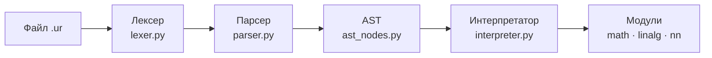

<div align="center">


<h1>U-Ray</h1>

### Свой язык программирования — от первых циклов до обучения нейросетей

Интерпретируемый язык с собственным синтаксисом, понятной семантикой и встроенными инструментами для ML.

<p>
  <a href="https://github.com/TechnoSwey/U-Ray/actions/workflows/ci.yml"></a>
  
  
  
</p>

<a href="#быстрый-старт">Быстрый старт</a> · <a href="#возможности">Возможности</a> · <a href="#примеры">Примеры</a> · <a href="#документация">Документация</a> · <a href="#тесты">Тесты</a>

</div>

---

U-Ray — компактный скриптовый язык, в котором можно изучать устройство интерпретатора и экспериментировать с нейросетями без обязательных сторонних библиотек.

```uray
func factorial(n) {
    if n <= 1 {
        return 1
    }
    return n * factorial(n - 1)
}

for i in range(1, 6) {
    print(i, "! =", factorial(i))
}
```

## Быстрый старт

Нужен Python 3.10 или новее. Обязательные внешние зависимости не требуются.

```bash
git clone https://github.com/TechnoSwey/U-Ray.git
cd U-Ray
./install.sh
./uray examples/save_load.ur
```

Без установки запускай файл через Python:

```bash
python3 main.py examples/save_load.ur
```

## Возможности

| Язык | Математика | Машинное обучение |
| --- | --- | --- |
| Функции, рекурсия, условия и циклы | Встроенные `math` и `linalg` | `nn`: dense-слои, MLP и backprop |
| Списки, словари, кортежи и строки | Векторы и матричные операции | SGD, Momentum, Adam и обучение по батчам |
| Предсказуемые правила типов и копирования | Чистый Python — базовый режим | Оценка, сохранение и загрузка моделей |

Ошибки языка сопровождаются позицией в файле. NumPy и PyPy можно подключить отдельно для ускорения.

## От исходника до результата



## Пример: нейросеть XOR

Создай MLP, обучи на четырёх точках и проверь результат:

```uray
import nn

X = [[0.0, 0.0], [0.0, 1.0], [1.0, 0.0], [1.0, 1.0]]
Y = [[0.0], [1.0], [1.0], [0.0]]

model = nn.mlp([2, 4, 1], "sigmoid")
history = nn.train(model, X, Y, epochs=2000, lr=0.5, batch_size=4, loss="mse", optimizer="sgd")
metrics = nn.evaluate(model, X, Y, "mse")
print("loss:", metrics[0])
print("accuracy:", metrics[1])
```

## Примеры

В репозитории сейчас три запускаемых ML-примера:

| Программа | Что показывает |
| --- | --- |
| [`save_load.ur`](examples/save_load.ur) | Обучение XOR, сохранение модели в JSON и загрузка для предсказаний |
| [`train_batch_example.ur`](examples/train_batch_example.ur) | Синтетические данные, MLP и пакетное обучение с Adam |
| [`progress.ur`](examples/progress.ur) | Показывает прогресс обучения и текущий loss после каждой эпохи |

[Каталог примеров и команды запуска →](examples/README.md)

## Документация

| Раздел | Содержание |
| --- | --- |
| [Язык](docs/LANGUAGE.md) | Синтаксис, типы, операторы, функции и семантика |
| [ML-модуль](docs/ML.md) | `math`, `linalg`, `nn`, оптимизаторы и рецепты обучения |
| [Архитектура](docs/ARCHITECTURE.md) | Устройство интерпретатора и точки расширения |

## Тесты

```bash
./run_tests.sh        # полный набор
./run_tests.sh --fast # быстрый набор без ml_*
```

Каждый push проверяется GitHub Actions — [последний запуск CI](https://github.com/TechnoSwey/U-Ray/actions/workflows/ci.yml).

## Лицензия

[MIT](LICENSE).

<div align="center">
  <sub>Сделано, чтобы разбирать язык по слоям — и проверять идеи на практике.</sub>
</div>
